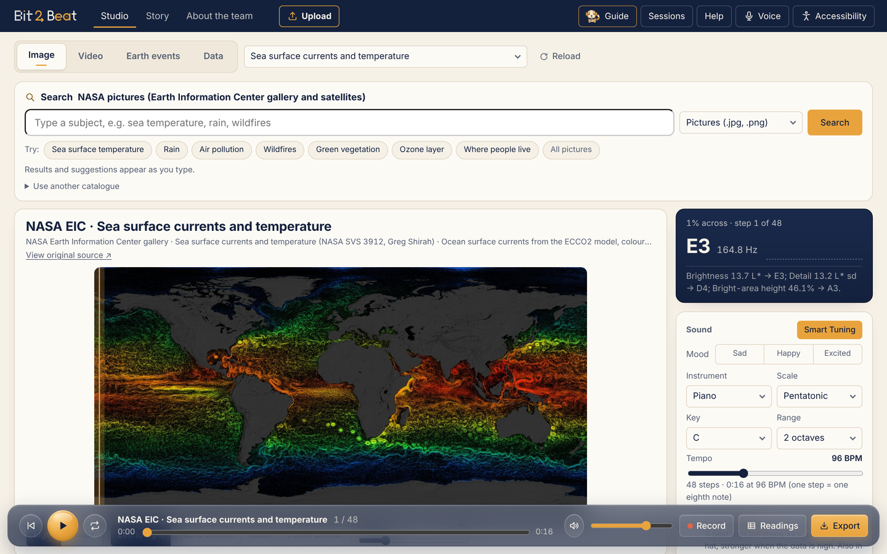
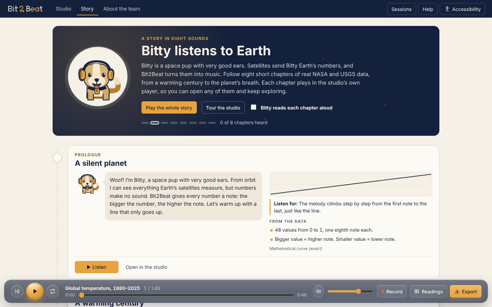

# Bit2Beat

**Listen to Earth data.** Bit2Beat turns NASA climate records, live natural events, your own spreadsheets, pictures and videos into music you can hear, follow as a score, and export as stereo or binaural audio, with an optional drum beat (Beta).

Built for the NASA Space Apps Challenge 2026, *The Earth Information Jukebox*, by Team Bit2Beat (see [Team](#team)).



New to Bit2Beat? Open the **Story** tab: Bitty the space pup plays eight chapters of real NASA and USGS data, one at a time, with facts worked out from the numbers you hear. Or press **Guide** (or `G`): Bitty shows you the whole studio or how one tab works, pointing at the real buttons.



## Open it

- **No install:** double-click `dist/Bit2Beat-Studio.html`. Everything (code, data, map, photos) is inside that one file, and it works offline.
- **From the source:** `npm start`, then open <http://localhost:8765>. (The built-in server supports video seeking. Opening `index.html` directly from disk blocks picture analysis in some browsers; use the server or the dist file.)

```bash
npm run check   # syntax check of every module
npm run build   # writes dist/Bit2Beat-Studio.html
npm test        # test groups: algorithms, file formats (incl. NetCDF, HDF5, GeoTIFF), story, voice, surround, page integrity, build
```

## What you can listen to

One **search** above the Image, Video and Data tabs finds any data set of the NASA Earth Information Center from plain words (keyword matches at once, then Gemini 3.8 Flash picks the best ones and the place; the key stays on the server in `api/search.js`).

| Tab | Sources | Notes |
| --- | --- | --- |
| **Data** | NASA GISTEMP global temperature 1880–2025 · NASA POWER Arctic (Svalbard) yearly 1981–2024 and daily 2025 · NASA POWER daily data for 18 places around the world and any year since 1981 (online) · **every time-series data set of the NASA Earth Information Center (earth.gov) data API**, for the whole world or a place (online) · NASA GISTEMP CSV sample · your own file (CSV, TSV, TXT, JSON, GeoJSON, Excel .xlsx, OpenDocument .ods) · four practice shapes | One **Upload** button in the top bar for every file: it opens the right tab by itself. CSV: comma, semicolon or tab, quoted cells, decimal commas, up to 6 numeric columns; a year/date/name column becomes the labels, `Temp (°C)` gives the unit. |
| **Video** | Bundled NASA Earth Information Center videos: GEDI forest height and global CO₂ · **a time-lapse of the latest 24–96 maps of any Earth Information Center data set** (online) · your own MP4/WebM, up to 200 MB | Two samples per second, each averaged over its half second. NASA presets are **read through their own colour bar**: forest height in metres and land in view, CO₂ in ppm and the area above ~420 ppm. Your videos play brightness, colour and motion of the picture, with empty background left out. The muted video follows the music: Play starts both. |
| **Earth events** | NASA EONET natural events (wildfires, storms, floods, sea ice…) and USGS earthquakes together, earthquakes as one more channel (electric piano) · offline sample | Played as one sweep across the map from west to east: further north = higher note, bigger = louder. An offline sample of both always works. Live sources update when online; if unavailable they use the last live copy saved in the browser, then a real snapshot bundled with the app. The header always says which one you hear. |
| **Scientific maps** (Image tab) | **Your NetCDF (.nc, .nc4, .cdf), HDF5 / NetCDF-4 (.h5, .hdf5, .he5) and GeoTIFF / Cloud-Optimized GeoTIFF (.tif) files, up to 5 GB** · the newest Earth Information Center map as **real values** · *Sunlight on Earth* (worked out from astronomy, offline) | Read in the browser, a few pieces at a time (nothing is uploaded anywhere). *What's inside* lists layers, units, dates and area. Listen to the **whole map** as a sweep, **one spot over time** (click the map or type latitude and longitude) or a **time-lapse**; missing values are silent; the read-out gives value, place and date under the pointer. CF conventions: scale/offset, fill values, valid range, time units, 0–360° longitudes, north-up. |
| **Image** | Bundled NASA EIC GEDI forest-height and global CO₂ stills · **the newest map of any Earth Information Center data set**, read through its own colour bar (online) · NASA GIBS satellite views (whole Earth today, Earth at night, Amazon, Himalaya, Greenland, Sahara) · bundled world map · two generated illustrations · your picture | Measure **Light** (CIE L* brightness, detail, height of bright areas), **Colour** (R, G, B) or, for NASA presets, **Colour key** (data values read through the colour bar). Empty background around a globe is silent. Scan left to right, top to bottom, Radar, or follow the pointer. |

## How numbers become sound

1. **Scaling.** Each series is scaled between its lowest and highest value. Series that share a unit (e.g. max, mean and min °C) share one range, so their real distance apart is kept. Event sizes that span orders of magnitude (wildfire area, iceberg area) use a log scale.
2. **Pitch.** The scaled value picks a note from the chosen key and scale over 1–3 octaves from C3: `index = round(v × (n − 1))` in the list of scale notes. This is monotonic and gives every scale degree the same share of the data range, so equal steps in the data sound like equal steps in the melody. Frequency is equal-tempered, A4 = 440 Hz.
3. **Time.** One step is an eighth note at the chosen tempo. Long series can be averaged into 240/120/60/30 steps (bucket means). Earth events are played west to east; with **Map distance** the gaps follow the real distance between events along the sweep.
4. **Loudness and direction.** For events, latitude sets the pitch (north = higher) and size (magnitude, area, wind) sets loudness and dot size. Any channel’s pitch direction can be flipped.
5. **Space.** Every channel is an audio object in a room (x left–right, y back–front, z height). Data moves left to right (or circles you); events and map places sit where they are on Earth: **west left, east right, north in front, south behind**. *Wrap the globe around me* puts 0° longitude ahead, east to the right, the date line behind and the north up high. The **trend rumble** plays the slow long-term trend as a deep tone to the subwoofer (LFE). Outputs: stereo, headphone 3D (binaural HRTF), 5.1, 7.1 and 7.1.4 (virtualised over headphones when the device has two outputs). A top view lights the speakers that play, and each speaker has a test button.

### Listening aids

- **What the data says** – trend (least-squares slope, R² check), highest/lowest with labels, and sudden jumps, in plain sentences you can have read aloud (`D`), with Pause / Resume and Stop.
- **Tick on sudden jumps** – a quiet click on readings that jump away from their neighbours. Detection uses a leave-one-out local line and the modified z-score (|z| ≥ 3.5, Iglewicz & Hoaglin), refitted without the flagged points, so smooth curves, seasons and steady trends are not flagged.
- **Reference tone** – a soft drone at the data’s baseline (e.g. GISTEMP’s 1951–1980 average) or its mean, so you hear above vs. below.
- **Links remember everything** – mode, source, sound settings, mix and play position live in the address bar, so a refresh or a shared link opens the same view.
- **Voice control** – on the first visit Bit2Beat asks (five seconds, Enter = yes) whether to turn it on; `V` toggles it. Say *play*, *pause*, *next*, *where am I*, *search for sea ice*, *go to video*, *violin*, *7.1*, *help*, *stop voice control*… Phrases the page does not know go to Gemini (`api/voice.js`), which may only answer with one of the same commands.
- Keyboard scrubbing (`←` `→`, `Shift` for bars, `Home`/`End`), live captions, screen-reader updates, high contrast, dark theme, text size, larger buttons, reduced motion, mono audio.

## Export

Stereo, binaural, 5.1, 7.1 and 7.1.4 WAV, ADM BWF (Dolby Atmos-ready objects), the readings as an **Excel workbook** or CSV, the notes as CSV (every step, value, note, Hz, start time, x/y/z) and the score as ABC or PNG. Files are rendered offline from the same plan you hear and normalised to −1 dBFS peak.


## Code layout

```text
index.html                  page markup (no inline logic)
src/styles/                 tokens · base · layout · components · dialogs · glass · polish
src/js/core/                pure, Node-testable logic
  music.js   scales, keys, value → note, normalisation
  stats.js   trend, sudden jumps, resampling, plain-language summary, suggestions
  plan.js    builds the full note plan (pitch, loudness, time, 3D position) used everywhere
  story.js   Bitty’s nine chapters and the facts worked out from their data
  bytes.js tiff.js netcdf3.js hdf5.js hdf5-data.js   lazy readers for scientific files
  science.js sci-source.js   one way into GeoTIFF / NetCDF / HDF5; maps into sound
  sunlight.js   sunlight on Earth from astronomy (built-in map)
  voice-commands.js   the voice grammar and the checks on Gemini's answers
  spotlight.js  where Bitty’s guide bubble and dimmed areas go
  image.js   L* and colour analysis of pixels
  csv.js     CSV parser with label and unit detection
  feeds.js   USGS, NASA EONET, NASA POWER (live + offline)
  eic.js     NASA Earth Information Center data API (STAC catalogue + raster statistics)
  geo.js     projection, land mask, coordinate repair
  score.js   ABC notation with correct accidentals and clefs
  spatial.js wav.js adm.js   3D panning, WAV and ADM BWF writers
src/js/audio/               engine (synth, renderers) · player (scheduler) · exporter
src/js/ui/                  one file per part of the page
src/js/data/                bundled real data snapshots and presets
src/js/app.js               state and wiring
scripts/build.js            single-file build
tests/core.test.js          tests
```

## Documentation

| Document | What is inside |
| --- | --- |
| [User guide](docs/USER-GUIDE.md) | Every tab, control and shortcut; sharing links; exporting; troubleshooting |
| [How it works](docs/HOW-IT-WORKS.md) | Every step from a number to a sound, with the formulas |
| [Data sources](docs/DATA-SOURCES.md) | Providers, endpoints, offline snapshots, data-quality fixes |
| [Accessibility](docs/ACCESSIBILITY.md) | Listening without seeing, visual and hearing options |
| [Architecture](docs/ARCHITECTURE.md) | Modules, data flow, URL state, performance, build |
| [Development](docs/DEVELOPMENT.md) | Scripts, tests, adding a data source, publishing |
| [Add your own data](docs/ADD-DATA.md) | The Earth Information Center API, other catalogues, CSV, and code |
| [Changelog](CHANGELOG.md) | What changed in each version |

## Team

| Name | Role |
| --- | --- |
| George Hany | Team leader |
| Mina Helal | Data Analyst |
| Steven Joseph | Integration lead |
| Mostafa Ragab | UI Specialist & Engine |
| Mostafa Mohammed | Core |

## Data credits

NASA GISS (GISTEMP v4), NASA POWER, NASA EONET, NASA GIBS, NASA Image and Video Library, USGS Earthquake Hazards Program. Music engraving by [abcjs](https://www.abcjs.net/) (MIT). Code released under the [MIT licence](LICENSE).
