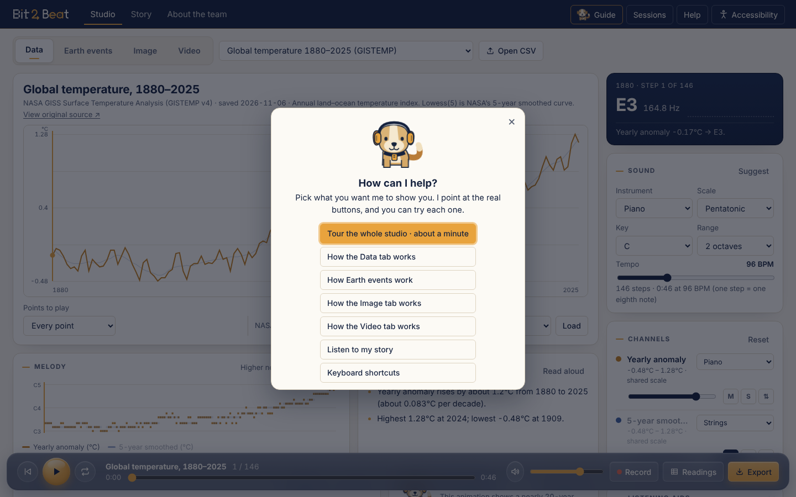
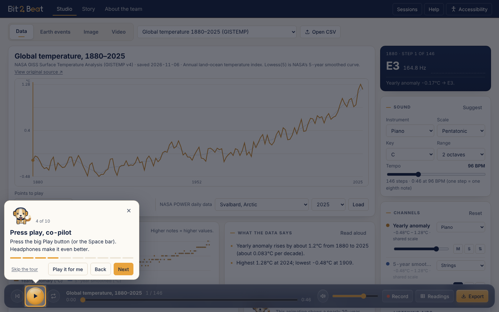
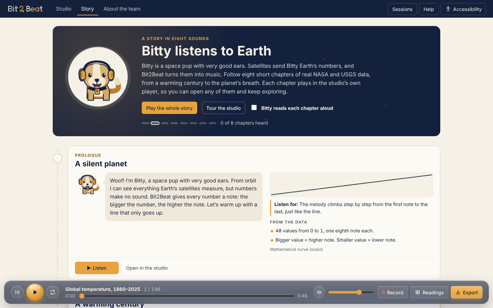
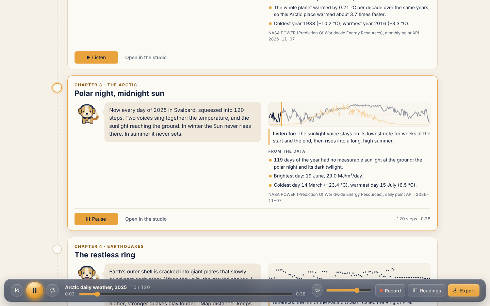
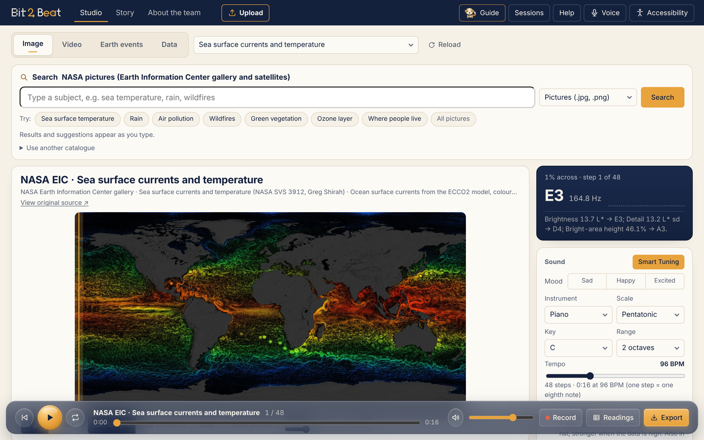
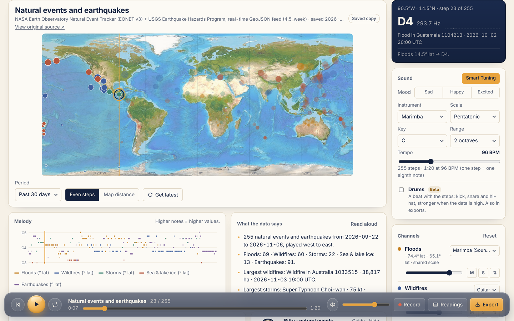

# User guide

Bit2Beat turns Earth data into music you can hear, read as a score and export. This guide walks through every part of the studio.

- [Opening Bit2Beat](#opening-bit2beat)
- [Bitty, your guide](#bitty-your-guide)
- [Bitty’s story](#bittys-story)
- [Reading aloud](#reading-aloud)
- [The studio at a glance](#the-studio-at-a-glance)
- [Data tab](#data-tab)
- [Earth events tab](#earth-events-tab)
- [Image tab](#image-tab)
- [Video tab](#video-tab)
- [Shaping the sound](#shaping-the-sound)
- [Reading what you hear](#reading-what-you-hear)
- [Saving, sharing and exporting](#saving-sharing-and-exporting)
- [Keyboard shortcuts](#keyboard-shortcuts)
- [Troubleshooting](#troubleshooting)

## Opening Bit2Beat

| Way | How | Needs internet? |
| --- | --- | --- |
| Single file | Double-click `dist/Bit2Beat-Studio.html` | No (live feeds and satellite views do) |
| From the source | `npm start`, then open <http://localhost:8765> | No |
| Online | GitHub Pages or any static host serving the repository root | Yes |

Bit2Beat runs fully in the browser. Nothing is uploaded: CSV files and pictures you open stay on your computer.

## Bitty, your guide

Bitty is a space pup with very good ears, and the guide of Bit2Beat. Press **Guide** in the top bar (or `G`) and Bitty asks *How can I help?*:

| Choice | What Bitty shows |
| --- | --- |
| **Tour the whole studio** (about a minute) | Tabs, source menu, chart, Play, Now playing, melody and summary, Sound, Channels, Earth events, Export and the Guide button |
| **How the Data tab works** | Picking a data set, Points to play, NASA POWER for any place and year, your own CSV, the summary, the Readings table |
| **How Earth events work** | Earthquakes or natural events, reading the map west to east, Even steps vs Map distance, Get latest and the Live / Saved / Bundled label, following one kind of event |
| **How the Image tab works** | Pictures and satellite views, Light / Colour / Colour key, the three scans, Steps |
| **How the Video tab works** | The video that follows the music, two notes per second, values read through the colour bar, your own video |
| **Listen to my story** | Opens the Story page |
| **Keyboard shortcuts** | Opens Help |

Bitty points at the real controls one at a time and dims the rest. Some steps ask you to try the control (press Play, open Earth events) and wait for you; **Do it for me** presses it for you. **Back**, **Next**, **Skip** and `Esc` always work.

- **First visit:** Bitty says hello once and offers the tour or the story; *Not now* is one click.
- **First time you open a tab:** Bitty’s card (under the score) offers *Show me* for that tab, or *No thanks*.
- Also from **Help → Let Bitty guide me**, **Guide** on Bitty’s card, the Story page, or `?tour` in the address (`?notour` turns the hello off).

## Bitty’s story

**Story** (top bar) is the easiest way in. Bitty, a space pup with very good ears, tells eight short chapters. Each one plays a real data set in the studio’s own player, so the sound, score and exports are exactly the studio’s.

| Chapter | You hear | Bitty sets |
| --- | --- | --- |
| Prologue · A silent planet | A rising line: bigger number, higher note | – |
| 1 · A warming century | NASA GISTEMP 1880–2025 | Reference tone at the 1951–1980 normal |
| 2 · The Arctic runs a fever | Svalbard yearly temperature 1981–2024 | Reference tone at the average |
| 3 · Polar night, midnight sun | Svalbard daily 2025, temperature and sunlight together | 120 averaged steps; *Sunlight* unmuted |
| 4 · The restless ring | USGS earthquakes, west to east | *Map distance* spacing |
| 5 · Fire, flood and ice | NASA EONET natural events | *Even steps* |
| 6 · Forests measured by laser | NASA EIC GEDI forest-height video | Real-time tempo |
| 7 · The planet breathes | NASA EIC DYAMOND CO₂ video | Real-time tempo |

Each chapter shows:

- Bitty’s narration and a **Listen for** hint (what to listen for).
- The **shape of the data** with a playhead while it plays.
- **From the data**: facts worked out from the numbers you hear (for example the warmest year, how much faster Svalbard warmed than the whole planet over the same years, the strongest quake). With live feeds they follow the live numbers.
- **Listen** (Pause) and **Open in the studio**, which keeps the chapter loaded so you can change instruments, mute channels or export.

**Play the whole story** plays the chapters one after another (it starts from the first chapter you have not heard). Tick **Bitty reads each chapter aloud** to hear the narration (your browser’s voice) before the music. Chapters you have heard get a tick; hear all eight to earn the **Earth Listener** badge. Progress is kept in this browser only.

## Reading aloud

**Read aloud** (in *What the data says*, or `D`) and Bitty’s story narration use your browser’s voice. While Bitty reads, a bar at the top of the screen (bottom on phones) shows what is being read and how far:

- **Pause** / **Resume** – stops and continues from the sentence where you paused.
- **Skip to the music** (story only) – ends the narration and starts the chapter’s sound.
- **Stop** – ends the reading (in the story, it also stops *Play the whole story*). `Esc`, or pressing **Read aloud** / `D` again, does the same.

## The studio at a glance

| Area | What it does |
| --- | --- |
| **Pages** (Studio · Story · About the team) | Story is Bitty’s guided listening journey; see above. |
| **Tabs** (Data · Earth events · Image · Video) | Choose what kind of thing to listen to. The menu beside them picks the source. |
| **Menus** | Open just below their button. Menus with six or more choices have a search box: type any words to narrow the list, `↑`/`↓` and `Enter` to choose, `Esc` to close. |
| **Source card** | The chart, map or picture you are hearing, its source line (where the numbers come from and when), and options for that tab. Hover to read a value; click to hear that step. |
| **Now playing** (navy panel) | The current step, its note and frequency, the reading behind it and live sound bars. |
| **Sound** | Instrument, scale, key, range and tempo. **Suggest** picks them from the shape of the data. |
| **Channels** | One row per data series: volume, instrument, **M**ute, **S**olo and **⇅** (flip pitch direction). |
| **Listening aids** | Shared pitch scale, ticks on sudden jumps, reference tone. |
| **Space & tone** | Output (stereo or binaural for headphones), movement, room and equaliser, and **Reset**. |
| **Melody** | Every note over time; the amber line is the playhead. |
| **What the data says** | Trend, highs and lows, sudden jumps, in plain sentences. **Read aloud** speaks them; press again to stop. |
| **Score** | Live sheet music of the lead channel; **Full score** shows every channel; **PNG** downloads it. |
| **Bitty’s card** | Bitty with short notes from the NASA Image and Video Library that follow what you are playing, a tip the first time you open a tab, and **Guide**. |
| **Guide** (top bar) | Bitty’s guide menu (`G`). |
| **Player bar** | Restart, Play/Pause, Repeat, position, volume, **Record**, **Readings** table and **Export**. |

## Searching the Earth Information Center

Above the Image, Video and Data tabs is one search for the whole NASA Earth Information Center catalogue.

- **Keyword search** (the default): type a subject such as *carbon dioxide*, *methane* or *fire*; results appear as you type. Everyday words work too (*swamp* finds wetlands, *trees* finds forest growth). While you type, **suggestions** open under the box (search ideas, and data sets marked *Play* that start at once; `↑` `↓` `Enter` pick one). The **Try:** ideas under the box run a search in one click; **All data sets** lists everything. **Clear** (or `Esc`) empties the search.
- **Gemini** (the sparkle button at the top right; amber when on): write what you want to hear in your own words, for example *methane from wetlands in the Amazon*, and press **Ask Gemini**. Gemini picks the best data sets and finds the place (its latitude and longitude, even if it is not one of the 18 places); the **Area** menu shows it. It only searches for Earth data: other questions get a polite “only Earth data” answer.

Choose a result to hear it in the tab that is open: **Image** draws its newest map, **Video** makes a time-lapse of the latest 24, 48 or 96 maps, **Data** plays one note per map (24, 60 or 120). Changing the area or the number of maps replays it. **Reload** (next to the menu) loads the current source again with the newest data.

AI mode needs the online version (bit2beat.vercel.app); keyword search also works in the single file. **Use another catalogue** searches any other STAC catalogue, such as NASA VEDA.

## Data tab

Pick a series from the menu:

- **Global temperature 1880–2025 (GISTEMP)** – NASA’s yearly land–ocean temperature anomaly. Higher = warmer. Turn on the *5-year smoothed* channel to hear the trend under the yearly wiggles.
- **Arctic (Svalbard) yearly temperature 1981–2024** – NASA POWER; the Arctic warms faster than the global average.
- **Arctic (Svalbard) daily weather 2025** – mean, max and min temperature and sunlight. Unmute *Sunlight* to hear the polar night as a run of the lowest note and the midnight sun as a long high plateau.
- **Practice shapes** – a rising line, a peak, two cycles and a curve that speeds up: learn what shapes sound like before real data.

Options:

- **Points to play** – long series can be averaged to 240, 120, 60 or 30 steps (each step is the mean of its bucket; labels become ranges).
- **NASA POWER daily data** – pick one of 18 places around the world and a year since 1981, then **Load** (online).
- **NASA Earth Information Center** – use the search above the tabs. Each note is one map: its average over the area, with the highest value as a second channel.
- **Open CSV** (or drop a file on the chart) – comma, semicolon or tab separated; up to six numeric columns; a year/date/name column becomes the labels; a unit in brackets (`Temp (°C)`) is detected.

## Earth events tab

- **Natural events and earthquakes** (default) – NASA EONET wildfires, storms, floods, sea and lake ice and more, and USGS earthquakes (magnitude 4.5+), from the past 7, 30 or 60 days, in one sweep. Each kind of event has its own channel and instrument; earthquakes are the electric piano.
- **Offline sample** of both, which always works.
- **Natural events only** and **Earthquakes only** (past day, week or month; magnitude 2.5+, 4.5+ or significant).

Events are played **from west to east**, as one sweep across the map, like reading it left to right:

| What you hear | Comes from |
| --- | --- |
| Pitch | Latitude: further north = higher note |
| Loudness and dot size | Size: earthquake magnitude, fire area, storm wind, ice area |
| Height in 3D sound | Earthquake depth (deep quakes sit lower) |
| Left–right in 3D sound | Longitude |

**Even steps** gives one event per eighth note. **Map distance** keeps the real gaps between events along the sweep, so clusters (the Pacific Ring of Fire) sound like clusters and empty oceans sound like pauses.

**Get latest** fetches the live feed. The pill next to the title says whether you hear *Live data*, a *Saved copy* from your last visit or the *Bundled snapshot*.

## Image tab

- **NASA Earth Information Center**: search above the tabs; the newest map of the data set is drawn in its own colours over the real spread of the data in the area.
- **Live NASA satellite views** (NASA GIBS): whole Earth today, Earth at night, Amazon, Himalaya, Greenland ice sheet, western Sahara. Choose the **Date** for daily views.
- **Works offline**: a world relief map and two generated illustrations (clearly labelled as not satellite data).
- **Open picture** (next to the Steps slider) – any PNG, JPG or WebP.

Options:

- **Light** – three voices: brightness (CIE L\*), detail (how much brightness varies) and the height of bright areas. **Colour** – red, green and blue. **Colour key** (NASA EIC stills) – the data value read through the picture's colour bar, and how much of each band shows data. Empty background is silent.
- **Left to right**, **Top to bottom** (a line moves down the picture, row by row; with binaural headphones the sound comes down too), **Radar** (a beam turns around the centre and reaches every corner of the picture, whatever its shape) or **Follow pointer** (hear the data under your mouse or finger: only the data value, and only where the picture shows data; the player bar steps aside until you choose another scan). Click the picture to jump to that place.
- **Steps** – how many bands the picture is cut into (16–160).

## Video tab

- **NASA EIC · GEDI forest height** – a globe of forest height measured by the GEDI lidar (2019–2020). You hear the **forest height shown** (m) and how much **land is in view** as the globe turns: the Amazon, Congo and South-East Asia rise in pitch.
- **NASA EIC · Global carbon dioxide** – the DYAMOND model of CO₂ in January–March 2020. You hear the **CO₂ shown** (ppm) and the **area above ~420 ppm**: plumes over East Asia and fire regions are louder and higher.
- **Open video** – your own MP4 or WebM (up to 200 MB). Bit2Beat plays its **brightness**, **colour** and **motion**; the empty background around a subject is left out. Analysis happens on your computer.

The NASA presets are read **through their own colour bar**, so the notes follow the data the visualisation shows, not just how bright it looks. Each note stands for half a second of video.

Press **Play**: the muted video follows the music. Click the picture to play or pause; step with `←` `→` and the video shows that exact moment. The tempo is set so the music runs in real time with the video; change it and the video speeds up or slows down to stay in step. *Motion* starts muted; unmute it in Channels.

## Shaping the sound

- **Scale**: Pentatonic (default, never sounds wrong), Major, Natural minor, Dorian, Harmonic minor, Blues, Hijaz (maqam) and Chromatic (every semitone, most precise).
- **Range**: 1, 2 or 3 octaves from C3 (plus the key).
- **Tempo**: 50–200 BPM; one data step is one eighth note.
- **Instruments**: Piano, Electric piano, Guitar, Marimba, Flute, Violin. Each channel can have its own; the Sound card and the first channel stay in step. **Drums (Beta)** add a beat (kick, snare, hi-hat) that gets stronger when the data is high.
- **Same pitch scale for same units** keeps max, mean and min temperature at their real distance apart.
- **Tick on sudden jumps** adds a quiet click on readings that jump away from their neighbours.
- **Reference tone** plays a soft drone at the data’s baseline (GISTEMP’s 1951–1980 average) or its mean, so you hear above vs. below.
- **Output**: stereo, or binaural (headphones, with 3D height cues).

## Reading what you hear

- **Readings** (or `T`) opens a table of every step: label, value, note, frequency and start time.
- **What the data says** summarises the trend (least squares, only called a rise when it is clear), extremes and sudden jumps.
- **Captions** under the current note say exactly which value became which note.

## Saving, sharing and exporting

- **The address bar remembers everything.** Page (Studio or Story), tab, source, sound settings, channel mix, image options and play position are kept in the link. Refresh and you are back where you were; send the link and others open the same view. (An uploaded file cannot travel in a link.)
- **Sessions** saves named setups in this browser.
- **Record** captures what you hear live (browser codec).
- **Export** renders exact files from the same notes: stereo WAV or binaural WAV (with the drums when they are on), the notes as CSV, and the score as ABC or PNG. **Readings** downloads every value as an Excel workbook or CSV. Audio is normalised to −1 dBFS.

## Keyboard shortcuts

| Key | Action |
| --- | --- |
| `Space` | Play / pause |
| `←` `→` | Step back / forward and hear that step (`Shift` = one bar) |
| `Home` `End` | First / last step |
| `L` | Repeat on / off |
| `D` | Read the data summary aloud (again to stop) |
| `G` | Bitty’s guide |
| `Esc` | Stop reading aloud; close the guide |
| `T` | Readings table |
| `?` | Help |

## Troubleshooting

| Problem | Fix |
| --- | --- |
| No sound | Press Play once (browsers only start audio after a click); check the volume and that a channel is not muted. |
| “Live data unavailable” | You are offline or the feed is down; Bit2Beat keeps playing the saved copy. |
| Satellite view is black or missing | That date has no imagery yet; pick an earlier date or an offline picture. |
| Page looks unchanged after an update | Hard-refresh (`Ctrl`/`Cmd` + `Shift` + `R`). |
